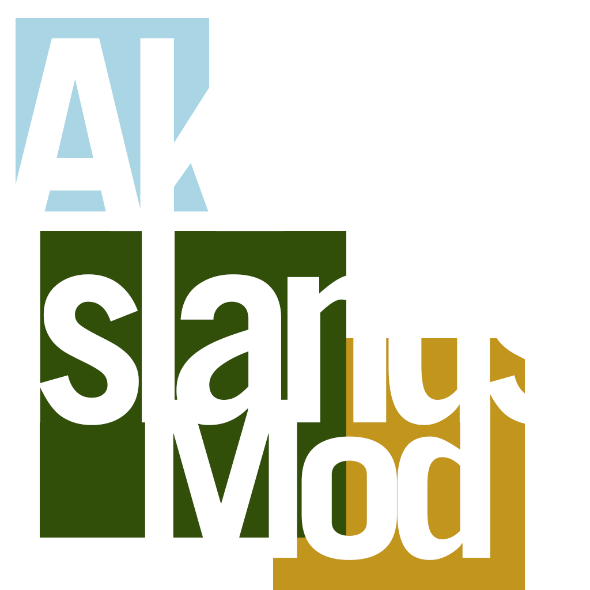

# Aki's Islands

  

**[Product of Achilleus](https://linktr.ee/achilleus_)** — original mod and maintenance by [Achilleus (Achilleus-1)](https://github.com/Achilleus-1).

Unofficial Minecraft mod; not approved by or affiliated with Mojang or Microsoft.

Create one continent, attached continents, or an island group surrounded by ocean. Preview the planned coastline before creating your world, randomize its shape, and optionally add gradual cold-north/temperate-middle/hot-south climate bands.

**Alpha · 0.3.0-alpha.** Latitude climate starts **off**. Compatibility checks pass with the documented mod profiles; individual village placement, long stream routes, and the new climate editor's visual click-through remain unverified. See [compatibility and verification limits](docs/COMPATIBILITY.md).

## Installation

For **Minecraft 1.21.1**, **NeoForge 21.1.265 or newer in the 21.1 series**, and **Java 21**.

1. Download `akis-islands-mod-1.21.1-0.3.0-alpha.jar` from the [alpha release](https://github.com/Achilleus-1/Akis-Islands-Mod/releases/tag/v0.3.0-alpha).
2. Place it in your NeoForge profile's `mods` folder and remove older Aki's Islands jars. For multiplayer, install the same version on the server and participating clients.
3. Open **Singleplayer → Create New World → World**, then select **World Type: Aki's Islands**.
4. Use the native **Customize** button beside World Type. Choose your layout, size, and landmass count, then **Apply layout**.

The mod has no required third-party mod dependencies. Keep the dependencies required by your other mods installed. The world-creation editor is for new worlds; installing the mod does not convert an ordinary existing save. Worlds using this generator need the mod to load.

## Layout and climate

| Control | Default / behavior |
| --- | --- |
| Layout | One continent, attached continents, or islands |
| Radius | 8,000 blocks; adjustable 1,000–100,000 |
| Landmasses | 2–6 for attached continents or islands |
| Randomize Shape | Another coastline without changing Minecraft's terrain seed |
| Climate | Optional latitude editor; **off** by default |
| Normal middle | **65%** of the planned north–south span; adjustable 50–90% |
| Band strength | **85%** by default; adjustable 0–100% |
| Transition length | **100%** by default; adjustable 50–200% |

North is -Z and south is +Z. Enabled latitude climate retains local variation, leaves humidity native, and uses the existing vanilla/modded biome selector. The normal middle stays broad while the ends gradually become colder or hotter. Climate settings and shape choices save per world.

The preview is a coastline/climate plan, not a rendered terrain or structure map. Rivers, lakes, mountains, shore details, features, and structures follow the active generator's rules. Other mods can still place bridges, structures, or above-water features at sea.

**Natural Temperature owns climate when installed.** Aki's latitude controls defer automatically to avoid overlapping temperature systems. Use that mod's settings, or omit it to use Aki's adjustable latitude mode. No external configuration is modified.

See the [full setup, data-pack, and settings guide](docs/GUIDE.md).

## Compatibility

The generator retains the active biome source and normal surface, cave, ore, feature, and structure stages. It changes large-scale continentalness and, only when selected, the temperature input used for biome placement.

Tested versions of **Terralith, Biolith, Biomes O' Plenty, Regions Unexplored, Streams Reflowing, Integrated Villages, Underwater Village**, and their dependencies coexist in the documented profiles. **Railways Untold** and **Natural Temperature** also pass the combined loading/noise checks, with their test-harness and climate-controller limitations documented separately.

This is **not a universal compatibility guarantee**. Structure starts are disabled by Minecraft's GameTest server, so those checks do not establish correct placement of every Integrated Village. Independent chunk generators and mods that bypass normal climate selection may need adapters. The [compatibility report](docs/COMPATIBILITY.md) separates completed checks from remaining gameplay tests.

## Development

Build with a **Java 21 JDK**: `./gradlew build` on Linux/macOS or `.\gradlew.bat build` on Windows. The installable jar is written to `build/libs/`. The first build downloads pinned Gradle, NeoForge, Minecraft development artifacts, and test dependencies.

Source is in `src/main/java/`; resources, translations, and metadata are in `src/main/resources/` and `src/main/templates/`. Versions are configured in `gradle.properties`. The `akis_islands` mod ID and generator IDs remain unchanged.

See [DEVELOPMENT.md](DEVELOPMENT.md) for project layout and checks, [CHANGELOG.md](CHANGELOG.md) for changes, [CONTRIBUTING.md](CONTRIBUTING.md) for contributions, and [SECURITY.md](SECURITY.md) for private reports. [Branding assets](BRANDING.md) contain the supplied cover and packaged icons.

## License and credits

**All Rights Reserved** for the original mod and artwork — see [LICENSE](LICENSE), [LEGAL.md](LEGAL.md), and [CREDITS.md](CREDITS.md). This preserves the project's existing license declaration.

The NeoForged MDK template retains its [MIT license](TEMPLATE_LICENSE.txt). The committed Gradle wrapper carries its own license. Compatibility-test mods are downloaded separately and are not bundled or redistributed with this mod.
